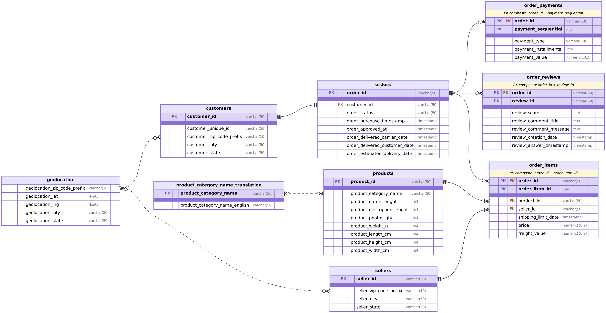

# Olist: analisi SQL su un e-commerce brasiliano

Il progetto è stato eseguito a scopo didattico per l'analisi di un e-commerce brasiliano con SQL (PostgreSQL, DBeaver) sul dataset pubblico *Brazilian E-Commerce Public Dataset by Olist*: controlli di qualità sui dati e sette domande di business, con il versionamento su Git e GitHub.

## Problema

Il dataset è fornito come file CSV; la descrizione di Kaggle non sempre corrisponde ai dati, per esempio `order_id` non è unico in tre tabelle. Prima di rispondere alle domande ho quindi verificato chiavi e cardinalità con query e ricostruito il diagramma ER, riportato nella sezione [Dati](#dati).

Le domande di business riguardano quattro ambiti:

1. **Ordini**: si è voluto esplorare per i singoli ordini effettuati se il pagato coincide con il dovuto (1) e in secondo luogo i ricavi mensili con la variazione rispetto al mese precedente (6).
2. **Spedizioni**: la spedizione di questi ordini con le relative tempistiche (2), eventuali ritardi e punteggi delle recensioni associati a questi ultimi (7).
3. **Prodotti**: i prodotti, che compongono i vari ordini, più remunerativi (4).
4. **Clienti e venditori**: i clienti che hanno effettuato almeno un secondo acquisto (3) e i venditori con ricavi maggiori della media dei venditori presenti nella stessa categoria di appartenenza (5).

Le sette domande di business a cui risponde il progetto sono elencate in [Risultati e insight](#risultati-e-insight).

## Dati

- Fonte: https://www.kaggle.com/datasets/olistbr/brazilian-ecommerce/data, licenza CC BY-NC-SA 4.0. I CSV non si trovano nel repository.
- Un totale di 9 tabelle per circa 100.000 ordini, valuta in reais e periodo che va dal 4 settembre 2016 al 17 ottobre 2018.

### Struttura delle tabelle

- **`customers`**

  - Righe: 99.441.
  - Chiave primaria: `customer_id`.
  - Collegamento: 1:1 con `orders`; 96.096 clienti distinti (`customer_unique_id`).

- **`orders`**

  - Righe: 99.441.
  - Chiave primaria: `order_id`.
  - Collegamento: FK `customer_id` verso `customers`, nessuna riga orfana.

- **`order_items`**

  - Righe: 112.650.
  - Chiave primaria: composta da (`order_id`, `order_item_id`).
  - Collegamento: FK verso `orders`, `products` e `sellers`, nessuna riga orfana; cardinalità 1:0..N con `orders`.

- **`order_payments`**

  - Righe: 103.886.
  - Chiave primaria: composta da (`order_id`, `payment_sequential`).
  - Collegamento: FK `order_id` verso `orders`; cardinalità 1:0..N.

- **`order_reviews`**

  - Righe: 99.224.
  - Chiave primaria: composta da (`order_id`, `review_id`).
  - Collegamento: FK `order_id` verso `orders`; cardinalità 1:0..N.

- **`products`**

  - Righe: 32.951.
  - Chiave primaria: `product_id`.
  - Collegamento: cardinalità 1:1..N con `order_items`.

- **`sellers`**

  - Righe: 3.095.
  - Chiave primaria: `seller_id`.
  - Collegamento: cardinalità 1:1..N con `order_items`.

- **`geolocation`**

  - Righe: 1.000.163.
  - Chiave primaria: nessuna (il CAP non è unico).
  - Collegamento: nessuna chiave esterna.

- **`product_category_name_translation`**

  - Righe: 71.
  - Chiave primaria: `product_category_name` (71 valori unici su 71 righe, da Kaggle).
  - Collegamento: traduce `products.product_category_name`; 2 categorie di `products` non hanno traduzione.

In `order_items`, `order_payments` e `order_reviews` l'`order_id` si ripete: la descrizione "unique identifier" di Kaggle non vale per queste tabelle e la chiave è composta.

## Metodo

Lo studio è stato scomposto in due fasi:

1. Controllo preliminare sui dati per conferma di relazioni tra tabelle, individuazione di Primary Key (PK) e Foreign Key (FK) e riscontro di eventuali anomalie.
2. Ricerca di insight nei dati.

### Caricamento in PostgreSQL

1. In importazione ho attivato "Set empty strings to NULL".
2. Ho omesso il prefisso `olist_` dai nomi delle tabelle, per chiarezza.
3. I CAP sono `varchar(10)` e non interi: i CAP brasiliani dovrebbero avere 8 cifre e, importati come interi, perderebbero gli zeri iniziali.
4. Le coordinate sono `double precision` e non `real`: con `real` sarebbero arrotondate a 6 cifre decimali, mentre nei dati ne hanno circa 15.
5. I prezzi sono `numeric(10,2)`.
6. Le date sono `timestamp`.
7. I commenti delle recensioni sono `text`, senza limitarne la lunghezza con `varchar`.

## Controlli di qualità sui dati

Per ogni tabella ho verificato che la chiave primaria fosse unica e senza `NULL`, che le chiavi esterne non avessero righe orfane e quale fosse la cardinalità delle relazioni; poi ho controllato la coerenza di date e stati degli ordini e i valori mancanti. Le chiavi sono verificate con query, non dichiarate come vincoli nel database. Il codice di ogni controllo, con la conclusione, è in `01_qualita_dati.sql`.

### Anomalie trovate

Le anomalie sono segnalate e non rimosse dalle tabelle: il loro trattamento si decide nelle singole analisi.

- **Date degli ordini**: 1.383 ordini hanno date fuori sequenza (1 approvazione prima dell'acquisto, 1.359 consegna al corriere prima dell'approvazione, 23 consegna al cliente prima della consegna al corriere).
- **Stato e date**: 8 ordini `delivered` senza data di consegna al cliente e 2 senza data di consegna al corriere; 6 ordini `canceled` con una data di consegna al cliente.
- **Ordini senza articoli**: 775, quasi tutti `unavailable`, `canceled` e `created` (plausibile); 2 `invoiced` e 1 `shipped` sono anomali. Nessuno è `delivered`.
- **Ordini senza recensione**: 768, di cui 646 `delivered` (circa lo 0,7% dei consegnati): la recensione non è obbligatoria.
- **Recensioni condivise**: 789 `review_id` compaiono su più ordini (per lo più due, pochi tre), con tutte le altre colonne identiche; la causa non è verificata.
- **Pagamenti**: 1 ordine `delivered` (settembre 2016) ha articoli e nessun pagamento; 9 pagamenti hanno importo 0 e 2 hanno 0 rate.
- **Prodotti**: 610 senza categoria, descrizione e foto (`NULL` insieme); 2 senza misure; 4 con peso 0, trattato come dato mancante.
- **Traduzione delle categorie**: 2 categorie di `products` senza traduzione (13 prodotti), oltre ai 610 prodotti senza categoria.
- **`geolocation`**: 19.015 CAP distinti su 1.000.163 righe e 261.831 duplicati esatti (circa 26%): un `JOIN` tramite CAP moltiplica le righe di clienti e venditori, quindi serve una riga per CAP prima di usarla.

## Risultati e insight

### Scelte comuni alle analisi

Il codice delle sette domande è in [`02_insight.sql`](02_insight.sql) con una sezione numerata per domanda.

- **Ricavo**: somma di `price` da `order_items`, spedizione esclusa, non il pagato (vedi domanda 1).
- **Ordini considerati**: dove si parla di ricavi, solo gli ordini `delivered`.
- **Vista `delivered_items_view`**: usata per le domande 4, 5 e 6, ha una riga per ogni articolo di un ordine `delivered` (110.197 righe) e unisce `order_items`, `orders`, `products` e la traduzione delle categorie, con la categoria già etichettata.
  - `LEFT JOIN` con la traduzione, per non perdere i prodotti senza traduzione.
  - Categoria con `COALESCE`: nome inglese, altrimenti portoghese per i 13 prodotti senza traduzione, altrimenti `senza_categoria` per i 610 senza categoria.

### 1. Confronto tra totale articoli e pagamenti

Ovvero quanto avrebbe dovuto pagare ogni cliente per ordine in base agli articoli, e quanto ha pagato davvero.

- **Metodo**: per ogni ordine ho confrontato il totale degli articoli (prezzo + spedizione, da `order_items`) con il totale dei pagamenti cioè `order_payments`, aggregando prima ciascuna tabella a una riga per ordine per evitare di moltiplicare le righe nel `JOIN`.

- **Risultato**:

  - **98,6% degli ordini** (98.092 su 99.441): il pagato coincide con il dovuto. Tra questi, 3 ordini sono senza articoli né pagamenti reali (0 = 0).
  - **1,1% degli ordini** (1.139): pagato superiore al dovuto. Per 772 si tratta di ordini senza articoli, quindi il dovuto non è calcolabile. Nei restanti 367 l'eccesso medio cresce con il numero di rate (da circa 0,3% con 1 rata a oltre il 20% con 13 o più rate): è coerente con un costo aggiuntivo sulle rate, ma non dimostrato, perché il dataset non contiene informazioni sugli interessi.
  - **0,2% degli ordini** (210): pagato inferiore al dovuto.

- **Scelta per le analisi successive**: il ricavo è il prezzo da `order_items`, spedizione esclusa, non il pagato.

### 2. Tempo di consegna medio per stato del cliente

Ho considerato solo gli ordini `delivered` con la data di consegna al cliente (96.470 su 96.478: gli 8 senza data sono esclusi) e ho misurato il tempo dall'acquisto alla consegna, convertito in giorni.

- **Risultato**: la media varia molto tra stati, da 8,8 giorni a São Paulo (SP) a 29,4 a Roraima (RR), e 9 stati su 27 superano le tre settimane. Qui i cinque più veloci e i cinque più lenti:

  | Stato | Giorni medi | Ordini |
  | ----- | -----------:| ------:|
  | SP    | 8,76        | 40.494 |
  | PR    | 11,99       | 4.923  |
  | MG    | 12,01       | 11.354 |
  | DF    | 12,97       | 2.080  |
  | SC    | 14,95       | 3.546  |
  | …     | …           | …      |
  | PA    | 23,77       | 946    |
  | AL    | 24,54       | 397    |
  | AM    | 26,43       | 145    |
  | AP    | 27,19       | 67     |
  | RR    | 29,39       | 41     |

  I più lenti sono anche tra i meno numerosi: RR, AP e AM hanno 41, 67 e 145 ordini. 

  Le medie dei gruppi piccoli (RR, AP, AC) sono meno affidabili; le cause della differenza (distanza, logistica) sono ipotesi non verificate.

### 3. Clienti che effettuano almeno un secondo acquisto

Il cliente è `customer_unique_id`; ho contato come acquisto ogni ordine, in tutti gli stati, numerando gli ordini di ciascun cliente con `ROW_NUMBER()`.

- **Risultato**: 2.997 clienti su 96.096 (circa il 3,1%) hanno fatto almeno un secondo ordine; tra loro il 91,6% ne ha fatti 2 e il 6,8% ne ha fatti 3, con un massimo di 17 (un solo cliente, non controllato). Quasi tutta la clientela compra una volta sola.

### 4. Top 3 prodotti per ricavi in ogni categoria

Dalla vista `delivered_items_view` ho sommato il ricavo per prodotto e categoria e ho numerato i prodotti dentro ogni categoria con `DENSE_RANK`, tenendo i primi 3.

- **Risultato**: 74 categorie e 220 righe. Con `DENSE_RANK`, 2 categorie hanno 4 prodotti per un pareggio e 3 ne hanno meno di 3. Il primo prodotto va da 180 reais (`fashion_childrens_clothes`) a 63.560 (`health_beauty`).

### 5. Venditori con ricavi sopra la media della loro categoria

Dalla vista `delivered_items_view`, il ricavo di ogni venditore è la somma di `price` per venditore e categoria; la media è quella dei ricavi dei venditori della stessa categoria.

- **Risultato**: su 6.398 coppie venditore-categoria, 1.298 (circa il 20,3%) sono sopra la media: pochi venditori grandi spostano la media verso l'alto. Con la disuguaglianza stretta le categorie con un solo venditore non compaiono; `senza_categoria` (247 coppie, circa il 3,9%) è inclusa nel confronto anche se raggruppa prodotti diversi.

  

### 6. Ordini e ricavi per mese, con variazione sul mese precedente

Dalla vista `delivered_items_view` ho raggruppato per mese di acquisto (`DATE_TRUNC`), contando gli ordini distinti e sommando `price`. La variazione sul mese precedente usa `LAG` ed è lasciata vuota quando il mese prima non è consecutivo (novembre 2016 manca): `CASE` sulla data e `NULLIF` contro la divisione per zero.

- **Risultato**: la serie è di 23 mesi (da settembre 2016 ad agosto 2018). I ricavi passano da circa 112.000 reais a gennaio 2017 a circa 925.000 a gennaio 2018; il picco è novembre 2017 (987.765 reais), e nel 2018 restano stabili. I mesi del 2016 hanno pochissimi ordini, quindi le loro variazioni non sono significative; la causa del picco di novembre 2017 non è verificata.

### 7. Ordini consegnati in ritardo e punteggio delle recensioni

Dalla tabella `orders` ho preso gli ordini `delivered` con entrambe le date e, con un `CASE`, li ho divisi in puntuali e in ritardo (data di consegna successiva alla data stimata). Le recensioni sono ridotte a una riga per ordine con la media dei punteggi, perché alcuni ordini ne hanno più di una. Poi le ho unite agli ordini con `INNER JOIN` e ho confrontato i due gruppi con un `GROUP BY`.

- **Risultato**: su 95.824 ordini analizzati, i 7.661 in ritardo (8,0%) hanno un punteggio medio di 2,57 e gli 88.163 puntuali di 4,29: 1,73 punti in meno.
  Esclusi 8 ordini senza data di consegna e 646 senza recensione; il risultato è un'associazione, non una prova che il ritardo sia la causa.

## Come eseguire

1. **Requisiti**: PostgreSQL e un client SQL (ho usato DBeaver). Crea un database vuoto, per esempio `olist`.
2. **Dati**: scarica i 9 file CSV dalla pagina di [Kaggle](https://www.kaggle.com/datasets/olistbr/brazilian-ecommerce/data); non sono nel repository.
3. **Importazione**: in DBeaver, con il tasto destro sul database, scegli *Importa dati* (CSV) per ciascun file. Imposta i nomi delle tabelle senza il prefisso `olist_` e i tipi indicati in [Caricamento in PostgreSQL](#caricamento-in-postgresql), con l'opzione "Set empty strings to NULL" attiva.
4. **Controlli**: esegui le query di [`01_qualita_dati.sql`](01_qualita_dati.sql) una alla volta; ognuna è preceduta dal suo commento e dalla conclusione.
5. **Analisi**: esegui [`02_insight.sql`](02_insight.sql) una sezione alla volta. La vista `delivered_items_view` si crea prima della domanda 4 e serve alle domande 4, 5 e 6: se la rilanci, `CREATE VIEW` dà errore perché la vista esiste già.
